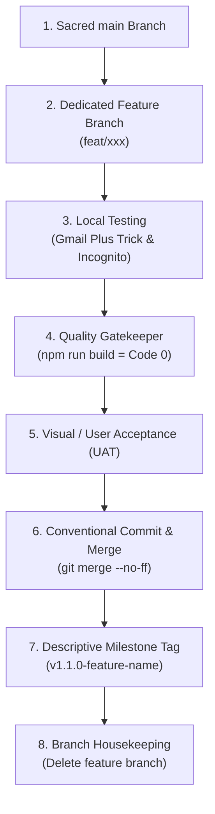

# 🏛️ The MNC Software Engineering Rulebook & SOP
**Enterprise-Grade Development Lifecycle for High-Velocity Solo Engineers & Teams**

---

## 🎯 Overview & Philosophy
In top-tier engineering organizations (Google, Meta, Amazon, Microsoft), code is never written or tested haphazardly. A rigid, automated, and repeatable **Standard Operating Procedure (SOP)** protects production from outages, eliminates regressions, and guarantees that every completed milestone is safely backed up and rollback-ready.

---

## 📜 The 7 Golden Laws of MNC Engineering



---

### LAW 1: The Sacred `main` Branch (Zero Direct Commits)
- **Principle**: `main` represents production. At any given second, `main` must be buildable, deployable, and bug-free.
- **Rule**: **NEVER code directly on `main`**.
- **Action**: Every bugfix, feature, or refactor must live in its own branch.
  - Features: `feat/<feature-name>`
  - Bugfixes: `fix/<bug-description>`
  - Tooling/Config: `chore/<task-name>`

---

### LAW 2: Multi-Role Testing Isolation (The Gmail Plus Alias Trick)
- **Problem**: When testing multiple roles, cookies and local storage collide.
- **Solution**: Gmail aliases (`name+test@gmail.com`) + Incognito window isolation.

---

### LAW 3: The Quality Gatekeeper (Zero Broken Builds)
- **Rule**: Never ask for review, merge, or push without passing the automated compiler gate:
  ```bash
  npm run build
  ```
- **Rule of Thumb**:
  - `Code 0` (Success): Green signal to proceed.
  - `Code 1` (Failure): Hard blocker. Fix all errors immediately before touching `main`.

---

### LAW 4: User Acceptance Testing (UAT) & Explicit Green Signal
- **Rule**: Passing the build is necessary, but not sufficient. Always verify visually on localhost.
- **Strict Protocol**: Merge into `main` will **ONLY** occur when you give the explicit green signal: **"Pass, merge karo"**.

---

### LAW 5: Conventional Commits
- Use standardized, human-readable commit messages:
  - `feat(scope): short description`
  - `fix(scope): short description`
  - `chore(scope): short description`

---

### LAW 6: Descriptive Milestone Tags (Permanent Restore Points)
- **Format**: `v<Major>.<Minor>.<Patch>-<feature-slug>`
  ```bash
  git tag -a v1.0.0-project-scaffold -m "Milestone 1: Project Scaffold & Design System Setup"
  ```

---

### LAW 7: Clean House (Auto-Delete Temporary Branches)
- Once a feature branch is merged into `main`, delete it immediately:
  ```bash
  git branch -d feat/<feature-name>
  ```

---

# 📋 Code Standards & Anti-AI Architectural Rulebook

## 📁 1. Structure & Organization Rules
- **Intent-Based Folders:** Folder name defines its domain (`components/navigation/`, `components/hero/`, `data/`). Forbidden: `misc/`, `common2/`, `temp/`.
- **Descriptive File Roles:** File name indicates its exact responsibility (`hero-section.tsx`, `proof-in-motion.tsx`). Forbidden: `temp.js`, `helper2.ts`.
- **Single Responsibility Principle:** Clean separation of UI, data definitions, and types.
- **Zero Mystery Files:** Clean root directory with zero abandoned scripts or drafts.

---

## 🚫 2. Zero-AI Code & Design Standards (100% Human Feel)
- **Zero Obvious Comments:** Absolutely no trivial comments (`// import react`, `// handle click`).
- **Lightweight, Direct Implementation:** No unnecessary abstraction layers.
- **Authentic Domain Copy:** Zero generic placeholders (*"Acme Corp"*, *"John Doe"*, *"✨ AI Powered"*).
- **Grounded, Tasteful UI Design:** Colors matching `viewstoclients.com` palette: Obsidian (`#080808`), Surface (`#101010`), Crimson (`#ff2626`), Warm off-white (`#f7f4ef`).
